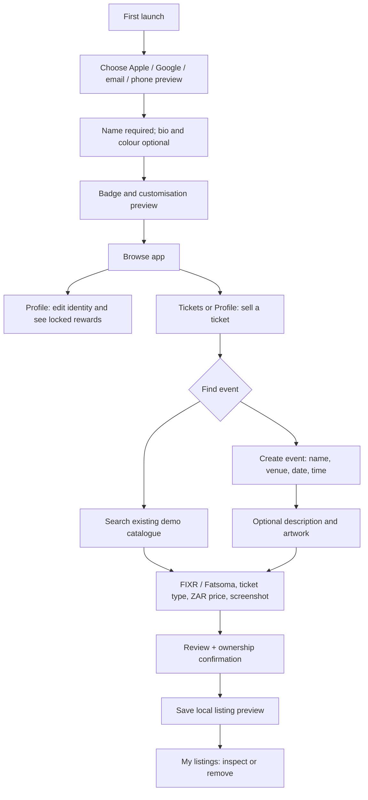

# Onboarding and selling prototype

## Scope

An interactive Expo wireframe, using the existing Ink / Coral / Lime palette and Archivo / IBM Plex Mono / Inter typography. Every member can browse buying options and create selling previews. No seller-role gate. This does not create real accounts, transmit tickets, publish listings, moderate events, collect payment or hold escrow.

## Implemented behavior

- Three short onboarding steps; Apple and Google selection previews; email and international phone format validation. No contact details or credentials are stored, and no verification message is sent.
- Persistent local display name, bio and starting colour, editable from Profile. Zero new-user activity. Existing badge artwork illustrates future rewards; no rewards are falsely awarded.
- Search the existing catalogue by event/venue. Only future, non-cancelled events are selectable. Catalogue entries remain clearly marked as demo data.
- Missing events require only name, venue/location, future date and start time. Date/time is explicitly Cape Town SAST, independent of device timezone. Description and artwork are optional. New events stay out of public discovery until a real moderation service exists.
- One ticket per listing. FIXR and Fatsoma provider choices, ticket type, ZAR asking price and an uncropped screenshot preview. Uses Expo's system image picker on native platforms and a file chooser on web. Cancellation preserves any previous selection. File-size validation caps images at 15 MB when the picker exposes size.
- Review preserves event details and labels uploaded proof unverified. Ownership confirmation is required and resets when returning to edit. Duplicate save presses are guarded.
- Listing metadata persists locally; removal requires an explicit second action. Save failures keep the form available for retry.
- Ticket screenshots and optional event images are session-only. No QR bytes or image URI are written to AsyncStorage. A saved preview states that the ticket must be reuploaded once secure storage exists. App deletion / browser-data clearing removes the local profile and previews.

## Production work next

1. Connect a real auth service: Apple and Google OAuth, email verification / magic link, phone OTP, session renewal and account recovery. Provider consoles, redirect URIs, Apple configuration and SMS credentials are required. Keep one identity with both buying and selling permissions.
2. Add server-owned users, events and listings plus private object storage. Authenticate uploads, enforce MIME/size rules server-side, avoid exposing QR assets in discovery and use short-lived access URLs for authorised reviewers. Replace local preview state with API responses.
3. Add an owner moderation queue with event duplicate detection, artwork review, approval/rejection and seller feedback. Listing review must be separate from event approval. Do not call a screenshot “verified.”
4. Validate FIXR and Fatsoma transfer eligibility against their current provider rules per event; implement email handover and receipt confirmation with a configured Aftermarket inbox. This prototype sends no provider email and invents no recipient address.
5. Connect payment/escrow lifecycle and idempotent state transitions before public selling. Award badges from confirmed server events: completed purchase, verified attendance and completed sale, never from taps or uploaded screenshots.
6. Run physical iPhone/iPad acceptance: Photos picker, iCloud-backed image, HEIC/PNG/JPEG, cancellation/limited access, VoiceOver, small screens, large text, keyboard avoidance, app restart and real auth redirects. Browser testing and an iOS bundle do not establish physical-device compatibility.

## Validation

Automated: `cd app && npm run typecheck && npm test`. Unit cases cover money boundaries, malformed amounts, calendar rollover/leap years, fixed SAST conversion, email and international phone validation. Export with `npx expo export --platform web` and `--platform ios`.

Manual browser acceptance: first-run email validation → profile name/bio/colour → rewards → app; search and select an existing event → Fatsoma image selection → review → save. Test image is a harmless app icon, not a real ticket. Further review outcomes are recorded below as they are completed.

Final review: profile and listing metadata survived browser reload; profile editing restored saved values and saved a changed colour; new-event creation rejected 30 February and accepted a valid date with description/artwork left blank; removal confirmation could be cancelled. A 390×844 browser viewport was visually inspected. Fixed step-to-step scroll retention, a literal newline in a heading, and corrupt-storage handling. Four test groups and TypeScript passed. Web and iOS Metro exports passed; physical Apple-device testing remains outstanding.
